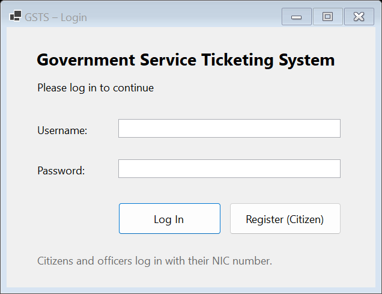
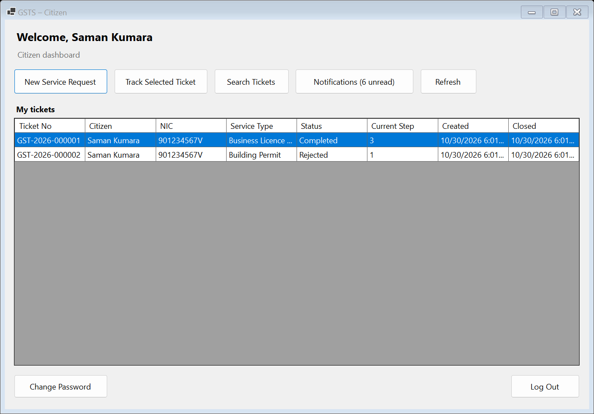
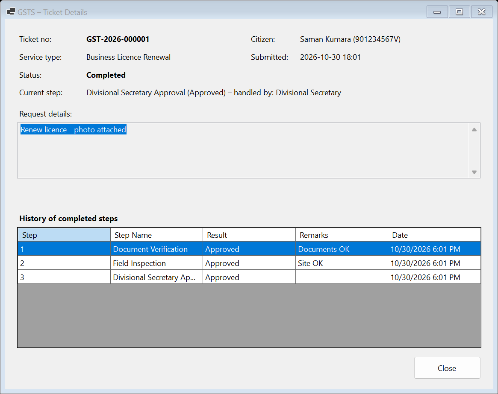
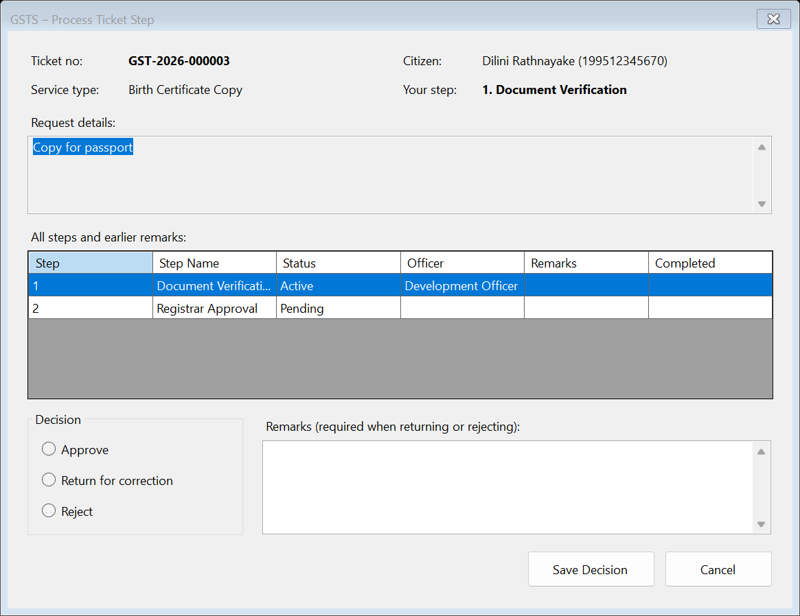
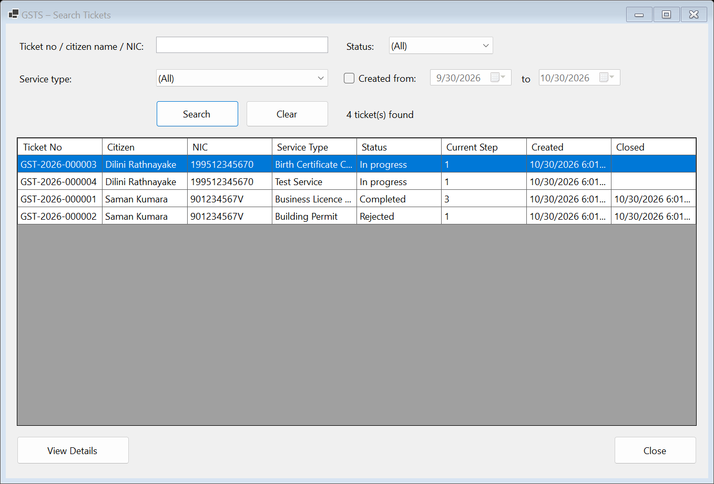
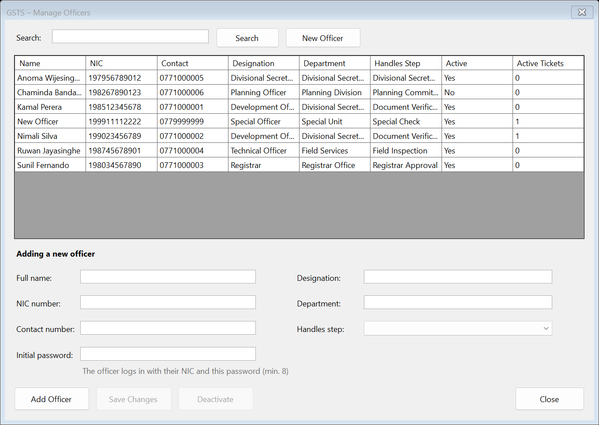
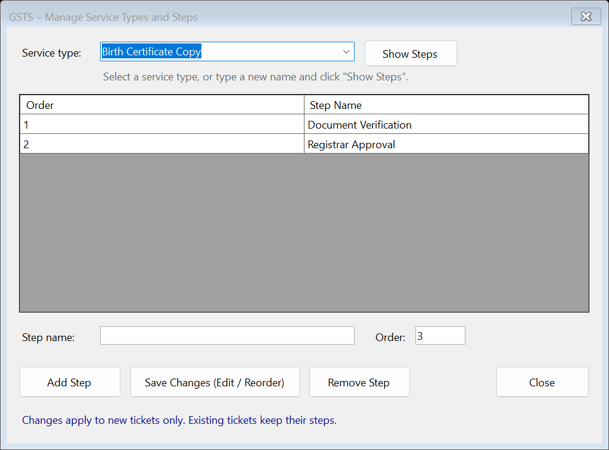
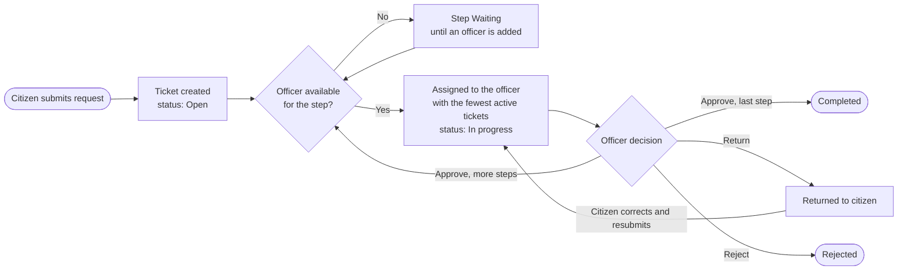
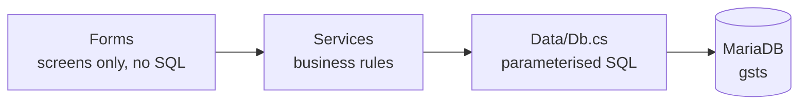
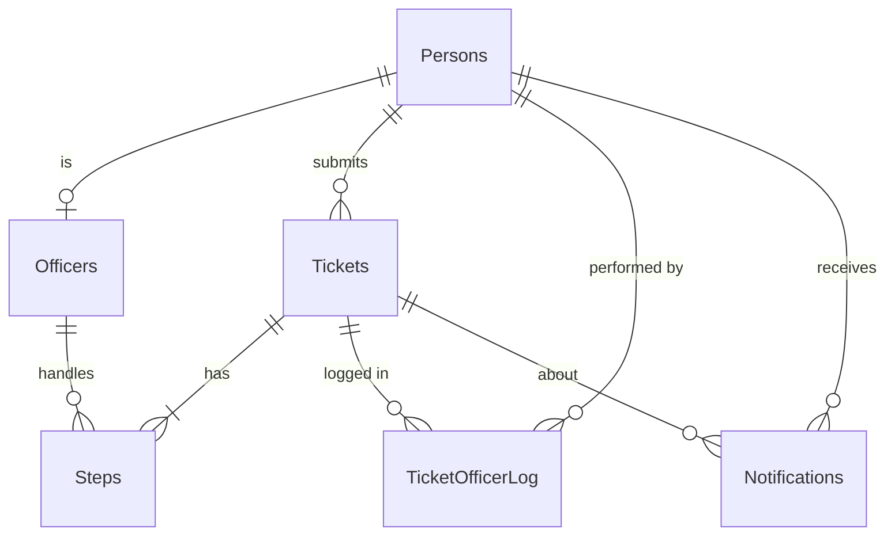

# 🏛️ Government Service Ticketing System (GSTS)


-003545?logo=mariadb)


A Windows desktop application that turns every government service request (a certificate, a
licence renewal or a permit) into a **uniquely numbered ticket**. The ticket moves through a
fixed sequence of processing steps handled by different officers. **Every action is logged**,
and the citizen is **notified** whenever something changes.

> Built for the **ITE1943 – ICT Project** module. The application implements the requirements,
> flowcharts and pseudocode of the submitted design report. Where the code differs from the
> report, the change and the reason are listed in [DEVIATIONS.md](DEVIATIONS.md).

<p align="center">
  
</p>

---

## 📑 Contents

- [The problem](#-the-problem)
- [Features](#-features)
- [Screenshots](#-screenshots)
- [How a ticket moves](#-how-a-ticket-moves)
- [Technology](#-technology)
- [Getting started](#-getting-started)
- [Default logins](#-default-logins)
- [Project structure](#-project-structure)
- [Database design](#-database-design)
- [Requirements traceability](#-requirements-traceability)
- [Non-functional requirements](#-non-functional-requirements)
- [Testing](#-testing)
- [Troubleshooting](#-troubleshooting)

---

## ❓ The problem

Today, citizens queue at an office and then wait with no idea where their request stands.
Inside the office, requests move between officers on paper or by phone, so they get delayed or
lost. Nobody can say who is responsible at a given moment, and there is no record of who did what.

**GSTS solves this with:**

| Problem | GSTS solution |
|---|---|
| No single record of a request | One ticket per request with a reference number like `GST-2026-000001` |
| Unclear responsibility | Each step is assigned automatically to the officer with the fewest active tickets |
| Citizens cannot track progress | Citizens see the status, the current step and in-app notifications |
| No accountability | An append-only audit log of every action |
| Delays are invisible | Reports on processing time and tickets pending too long |

---

## ✨ Features

### 👤 Citizen
- Register with NIC, contact number and address (input is validated and duplicate NICs are rejected)
- Submit a service request and receive a reference number
- Track each ticket: its status, current step, the designation of the officer handling it, and the history of completed steps
- Correct and **resubmit** a ticket that was returned for correction
- Receive notifications and mark them as read

### 🧑‍💼 Officer
- See the list of tickets assigned to them
- Open a ticket, read the earlier remarks, and **Approve**, **Return for correction** or **Reject** it
- On approval, the ticket moves automatically to the next step and officer

### 🛠️ Administrator
- Add, edit, deactivate and search officers
- Define service types and their ordered processing steps
- Reassign a ticket, for example when an officer is on leave
- Produce reports: tickets by status, tickets by service type, average processing time, and tickets pending longer than *N* days

### 🔐 For everyone
- Role-based login, with login disabled after 3 failed attempts
- Search and filter tickets by keyword, status, service type and date range. Each user sees only what their role allows
- Change password and log out

---

## 📸 Screenshots

| Citizen dashboard | Ticket tracking |
|---|---|
|  |  |

| Officer – process a step | Search tickets |
|---|---|
|  |  |

| Admin – manage officers | Admin – service steps |
|---|---|
|  |  |

---

## 🔄 How a ticket moves



Every decision writes a log entry and sends a notification. The steps that change several tables
run in a **single database transaction**, so either everything is saved or nothing is.

---

## 🧰 Technology

| Layer | Technology |
|---|---|
| Language / GUI | C# · Windows Forms · .NET 10 |
| Database | MariaDB 10.4 (the MySQL that comes with XAMPP) |
| Data access | Plain ADO.NET with [MySqlConnector](https://mysqlconnector.net/), the only NuGet package |
| Password security | PBKDF2-SHA256 with a random salt and 100,000 iterations (built into .NET) |
| IDE | Visual Studio Community 2026 |

The project deliberately uses no ORM, dependency-injection framework or third-party UI library,
which keeps every line of code easy to read and explain.

---

## 🚀 Getting started

### Quick install (setup file)
For evaluators and office PCs. No Visual Studio or .NET install is needed.

1. Install [XAMPP](https://www.apachefriends.org/) and click **Start** next to **MySQL** in the XAMPP Control Panel.
2. Run **`GSTS-Setup.exe`**.
3. On the **Database connection** page, keep the defaults (`localhost`, `3306`, `root`, no password) unless your MySQL is set up differently.
4. Leave **Create the GSTS database with the sample data** ticked on the first install.
   ⚠️ This deletes any existing `gsts` database.
5. Finish the setup and start **GSTS** from the Start menu or the desktop shortcut. Log in with one of the [default logins](#-default-logins).

The connection settings are saved in `gsts.config` in the install folder (`C:\Program Files\GSTS`).
To change them later, edit that file and restart GSTS. Uninstall from **Settings → Apps**.

**Building the setup file** (developers only) needs the .NET 10 SDK and
[Inno Setup 6](https://jrsoftware.org/isdl.php):
```powershell
powershell -ExecutionPolicy Bypass -File Installer\build-installer.ps1
```
The result is `Installer\Output\GSTS-Setup.exe`.

### Run from source

#### Prerequisites
- Windows 10 or 11
- [Visual Studio 2026](https://visualstudio.microsoft.com/) with the **.NET desktop development** workload (or the .NET 10 SDK)
- [XAMPP](https://www.apachefriends.org/) (for MariaDB/MySQL)

#### 1. Get the code
```bash
git clone https://github.com/NaradaJ/GSTS.git
cd GSTS
```

#### 2. Start the database
Open the **XAMPP Control Panel** and click **Start** next to **MySQL**.

#### 3. Create the database
Run the two scripts in this order.

> ⚠️ `01_schema.sql` **deletes** any existing `gsts` database before creating it again.

**Option A – phpMyAdmin:** open <http://localhost/phpmyadmin>, go to **Import**, then import
`Database/01_schema.sql` followed by `Database/02_seed.sql`.

**Option B – command line** (from the project folder):
```powershell
cmd /c "C:\xampp\mysql\bin\mysql.exe -u root < Database\01_schema.sql"
cmd /c "C:\xampp\mysql\bin\mysql.exe -u root < Database\02_seed.sql"
```

#### 4. Run the application
- **Visual Studio:** open `GSTS.sln` and press **F5**
- **Command line:**
  ```powershell
  dotnet run --project GSTS
  ```
  Run this from the folder that contains `GSTS.sln`. From the folder above it, use
  `dotnet run --project GSTS\GSTS`.

#### 5. Log in
| Role | Username | Password |
|---|---|---|
| Administrator | `admin` | `Admin@123` |
| Officer | `198512345678` | `Officer@123` |
| Citizen | `901234567V` | `Citizen@123` |

The full list of demo accounts is in [Default logins](#-default-logins).

> If your MySQL `root` user has a password, or MySQL runs on a port other than 3306, update the
> connection string in [`GSTS/AppConfig.cs`](GSTS/AppConfig.cs).

---

## 🔑 Default logins

Citizens and officers log in with their **NIC number**.

| Role | Username | Password | Handles step |
|---|---|---|---|
| Administrator | `admin` | `Admin@123` | – |
| Officer (Kamal Perera) | `198512345678` | `Officer@123` | Document Verification |
| Officer (Nimali Silva) | `199023456789` | `Officer@123` | Document Verification |
| Officer (Sunil Fernando) | `198034567890` | `Officer@123` | Registrar Approval |
| Officer (Ruwan Jayasinghe) | `198745678901` | `Officer@123` | Field Inspection |
| Officer (Anoma Wijesinghe) | `197956789012` | `Officer@123` | Divisional Secretary Approval |
| Officer (Chaminda Bandara) | `198267890123` | `Officer@123` | Planning Committee Approval |
| Citizen (Saman Kumara) | `901234567V` | `Citizen@123` | – |
| Citizen (Dilini Rathnayake) | `199512345670` | `Citizen@123` | – |

**Sample service types**

| Service type | Processing steps |
|---|---|
| Birth Certificate Copy | Document Verification → Registrar Approval |
| Business Licence Renewal | Document Verification → Field Inspection → Divisional Secretary Approval |
| Building Permit | Document Verification → Field Inspection → Planning Committee Approval |

> These are demo accounts. Change the passwords if you use the system with real data.

---

## 🗂️ Project structure

The interface, business logic and database access are kept in separate folders (NFR7):

```
GSTS/
├── GSTS.sln
├── Database/
│   ├── 01_schema.sql        6 tables, constraints, append-only log triggers
│   └── 02_seed.sql          sample users, officers and service types
├── GSTS/                    Windows Forms project
│   ├── Program.cs           start-up, database check, global error handler
│   ├── AppConfig.cs         connection string
│   ├── Session.cs           the logged-in user
│   ├── Data/Db.cs           the ONLY class that runs SQL (always parameterised)
│   ├── Services/            business logic – the pseudocode functions of the report
│   ├── Models/              Person, Officer, Ticket, Step
│   ├── Helpers/             PasswordHasher, Validator, Messages, UiHelper
│   └── Forms/               15 screens (each with a .Designer.cs for the Form Designer)
├── Installer/
│   ├── GSTS.iss             Inno Setup script (setup wizard, database page)
│   └── build-installer.ps1  publishes the app and builds GSTS-Setup.exe
├── docs/screenshots/
├── DEVIATIONS.md            differences from the design report, with reasons
└── README.md
```



A form reads the user's input, calls one service method, and shows the `Result` message that comes back.

---

## 🗄️ Database design

The six tables from Section 3.0 of the report:



| Table | Purpose |
|---|---|
| **Persons** | Login and basic details of every user (Citizen, Officer, Admin) |
| **Officers** | Designation, department and the step the officer handles |
| **Tickets** | One row per request: reference number, citizen, service type, status, dates |
| **Steps** | The ordered steps of each ticket. *Template* rows (`ticket_id IS NULL`) define each service type |
| **TicketOfficerLog** | The audit trail. Database triggers block every UPDATE and DELETE |
| **Notifications** | Messages to users, with a read/unread flag |

**Ticket status:** `Open` → `In progress` → `Completed`, or `Returned` / `Rejected`

---

## 🔗 Requirements traceability

| Req. | Requirement | Code | Screen |
|---|---|---|---|
| FR1 | User registration | `AuthService.RegisterUser` | RegisterForm |
| FR2 | Login and role-based access | `AuthService.Login` | LoginForm |
| FR3 | Submit service request | `TicketService.CreateTicket` | NewTicketForm |
| FR4 | Automatic assignment | `TicketService.AssignOfficer` | *(automatic)* |
| FR5 | View assigned tickets | `TicketService.ViewAssignedTickets` | OfficerDashboardForm |
| FR6 | Process a ticket step | `TicketService.ProcessStep` | ProcessStepForm |
| FR7 | Activity logging | `CommonService.InsertLog` + triggers | *(automatic)* |
| FR8 | Notifications | `CommonService.CreateNotification`, `NotificationService` | NotificationsForm |
| FR9 | Track ticket status | `TicketService.GetTicket`, `GetCompletedSteps` | TicketDetailsForm |
| FR10 | Search and filter | `TicketService.SearchTickets` | SearchTicketsForm |
| FR11 | Resubmit returned ticket | `TicketService.ResubmitTicket` | TicketDetailsForm |
| FR12 | Manage officers | `AdminService.AddOfficer / EditOfficer / DeactivateOfficer` | ManageOfficersForm |
| FR13 | Manage service types and steps | `AdminService.AddTemplateStep / EditTemplateStep / RemoveTemplateStep` | ManageServiceStepsForm |
| FR14 | Reassign ticket | `AdminService.ReassignTicket` | ReassignTicketForm |
| FR15 | Reports | `AdminService.GenerateReport` | ReportsForm |
| FR16 | Change password / log out | `AuthService.ChangePassword`, `Session.Clear` | ChangePasswordForm |

Each method name matches its pseudocode function in the report, and a comment above it names the requirement.

---

## 🛡️ Non-functional requirements

| NFR | How it is met |
|---|---|
| **NFR1 Usability** | Consistent layout, a label on every input, format hints, clear error messages |
| **NFR2 Performance** | Indexed queries, and lists load directly into grids |
| **NFR3 Security** | Salted PBKDF2 password hashes; **every** query uses parameters; screens and data are limited by role |
| **NFR4 Data integrity** | Foreign keys, UNIQUE and CHECK constraints; transactions with rollback |
| **NFR5 Reliability** | A start-up database check and a global error handler, so a stopped MySQL shows a clear message instead of a crash |
| **NFR6 Auditability** | The log is append-only (enforced by database triggers) and every entry is timestamped |
| **NFR7 Maintainability** | Forms / Services / Data layers, with a requirement comment on each method |
| **NFR8 Portability** | Runs on any Windows PC with .NET and XAMPP |
| **NFR9 Scalability** | Indexes on status, dates, officer/step and notifications |
| **NFR10 Cost** | All tools used are free |

---

## 🧪 Testing

The business logic was tested against the real database with a 64-check scenario covering
FR1–FR16. All 15 screens were opened and loaded with live data for each role.

**Manual walkthrough** (follows the report's flowcharts):

1. **Register** a citizen. Try an empty field, an invalid NIC, and an existing NIC.
2. **Login** with a wrong password 3 times. Login is then disabled for the session.
3. As `901234567V`, **create** a *Business Licence Renewal* request and note its reference number.
4. As `198512345678`, **approve** it. It moves to *Field Inspection*.
5. As `198745678901`, **return** it with remarks.
6. As the citizen, **edit and resubmit** it. It goes back to the same officer.
7. Approve the remaining steps. The ticket becomes **Completed** and notifications appear.
8. **Search** as each role. Each one sees only the tickets it is allowed to see.
9. As admin, **reassign** an open ticket. An officer for the wrong step is refused.
10. Generate each **report**, and try an invalid date range.
11. **Add, edit and deactivate** an officer. An officer with active tickets cannot be deactivated.
12. Stop MySQL in XAMPP. The app shows a clear message instead of crashing.

---

## 🩺 Troubleshooting

| Problem | Fix |
|---|---|
| *Cannot connect to the database* | Start **MySQL** in the XAMPP Control Panel |
| *Unknown database 'gsts'* | Run `Database/01_schema.sql`, then `02_seed.sql` |
| *Access denied for user 'root'* | Put your MySQL password in `GSTS/AppConfig.cs` |
| The project will not open in Visual Studio | Install the **.NET desktop development** workload (.NET 10) |
| Login is disabled | 3 failed attempts were made. Restart the application |

---

## 📚 Scope

**Out of scope** (as defined in the report): online payments, SMS and email gateways, a web or
mobile front end, document scanning, and integration with other government systems. These are
listed as possible future work.

---

<p align="center"><sub>ITE1943 – ICT Project · Government Service Ticketing System</sub></p>
