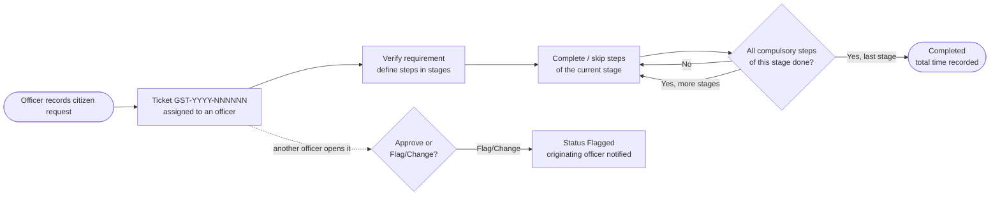
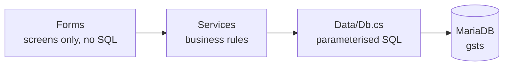
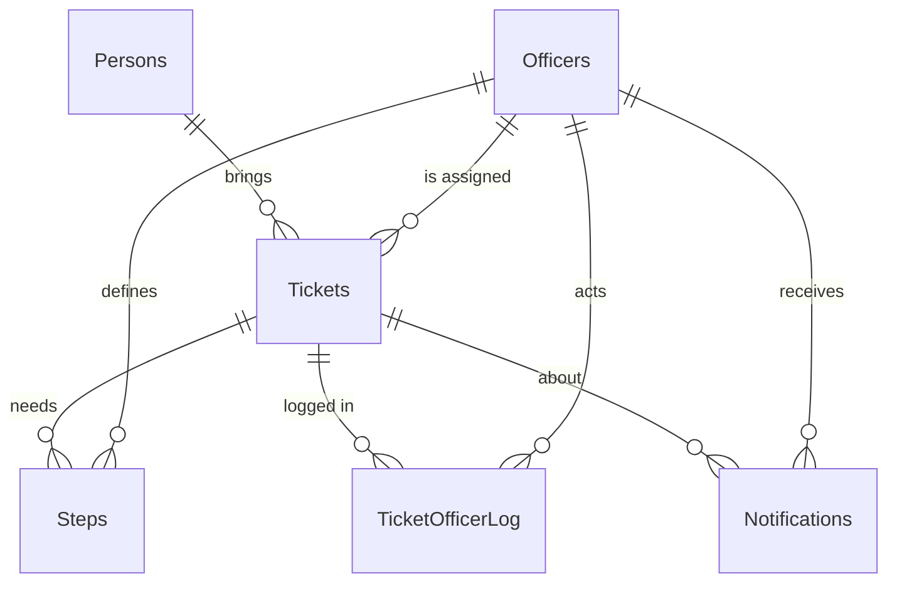

# 🏛️ Government Service Ticketing System (GSTS)


-003545?logo=mariadb)


A Windows desktop prototype for a **single government office**. An officer records each citizen
request as a **uniquely identified ticket**, defines the steps and documents it needs (marking the
compulsory ones), and moves it stage by stage to completion. When another officer takes over, they
must **approve or flag** the previous officer's work first. **Every action is logged** with the
officer and the time, and the **elapsed time** is always visible.

> Built for the **ITE1943 – ICT Project** module. The application implements the submitted design
> report **E2510192 (Jayasuriya N.K.)**: FR1–FR11, the five non-functional requirements,
> Flowcharts 1–5 and the pseudocode in §3.4. How the report's open design points were settled is
> recorded in [DEVIATIONS.md](DEVIATIONS.md).

---

## 📑 Contents

- [The problem](#-the-problem)
- [Features](#-features)
- [How a ticket moves](#-how-a-ticket-moves)
- [Technology](#-technology)
- [Getting started](#-getting-started)
- [Officer accounts](#-officer-accounts)
- [Project structure](#-project-structure)
- [Database design](#-database-design)
- [Requirements traceability](#-requirements-traceability)
- [Non-functional requirements](#-non-functional-requirements)
- [Testing](#-testing)
- [Troubleshooting](#-troubleshooting)
- [Scope](#-scope)

---

## ❓ The problem

Government offices in Sri Lanka commonly handle walk-in requests such as identity-document renewals
and certificates on paper. There is no consistent way to record a request, assign responsibility,
track the steps and documents it needs, or keep a reliable history when several officers handle it.
This leads to lost paperwork, duplicated effort, inconsistent service and limited accountability.

---

## ✨ Features

The four functionalities and the supporting feature of the report (§1.4, §3.3):

| | Functionality | What the officer does |
|---|---|---|
| **F1** | Ticket intake and assignment | Records the citizen's name, ID number, phone and reason for visit; gets a unique ticket ID; assigns the ticket to themselves or another officer |
| **F2** | Requirement verification and step definition | Saves the requirement verified with the citizen; adds, edits and orders steps or documents in stages; marks compulsory steps (shown with \*) |
| **F3** | Step completion and progression | Marks steps completed, skips optional ones, and progresses the ticket. Progression is blocked while a compulsory step of the current stage is incomplete |
| **F4** | Officer review, flagging, notes and logging | An officer who is not the last officer who acted must choose **Approve** or **Flag/Change** before editing. Flagging notifies the officer who defined the workflow. Every action takes an optional note and is logged |
| **Lookup** | Ticket status lookup | Any officer searches by ticket ID, citizen name or NIC (an empty search lists the completed tickets) and sees the citizen's details, status, elapsed time, current and previous handlers, steps and the full activity log (newest first) |

---

## 🔄 How a ticket moves



Each change and its log entry are saved in a **single database transaction**, so either both are
saved or neither is.

---

## 🧰 Technology

| Layer | Technology |
|---|---|
| Language / GUI | C# · Windows Forms · .NET 10 |
| Database | MariaDB 10.4 (the MySQL that comes with XAMPP) |
| Data access | Plain ADO.NET with [MySqlConnector](https://mysqlconnector.net/), the only NuGet package |
| Password security | PBKDF2-SHA256 with a random salt and 100,000 iterations (built into .NET) |
| IDE | Visual Studio Community 2026 |

---

## 🚀 Getting started

### Prerequisites
- Windows 10 or 11
- [Visual Studio 2026](https://visualstudio.microsoft.com/) with the **.NET desktop development** workload (or the .NET 10 SDK)
- [XAMPP](https://www.apachefriends.org/) (for MariaDB/MySQL)

### 1. Get the code
```bash
git clone https://github.com/NaradaJ/Project_3.git
cd Project_3/GSTS
```

### 2. Start the database
Open the **XAMPP Control Panel** and click **Start** next to **MySQL**.

### 3. Create the database
Run the two scripts in this order.

> ⚠️ `01_schema.sql` **deletes** any existing `gsts` database before creating it again.

**Option A – phpMyAdmin:** open <http://localhost/phpmyadmin>, go to **Import**, then import
`Database/01_schema.sql` followed by `Database/02_seed.sql`.

**Option B – command line** (from the `GSTS` folder):
```powershell
cmd /c "C:\xampp\mysql\bin\mysql.exe -u root < Database\01_schema.sql"
cmd /c "C:\xampp\mysql\bin\mysql.exe -u root < Database\02_seed.sql"
```

### 4. Run the application
- **Visual Studio:** open `GSTS.sln`, set **GSTS** as the startup project and press **F5**
- **Command line:**
  ```powershell
  dotnet run --project GSTS
  ```

> If your MySQL `root` user has a password, or MySQL runs on a port other than 3306, update the
> connection string in [`GSTS/AppConfig.cs`](GSTS/AppConfig.cs).

---

## 🔑 Officer accounts

Officer accounts are pre-registered (Report §1.4) by `02_seed.sql`. Every password is `Officer@123`.

| Officer | Designation | Username |
|---|---|---|
| Kamal Perera | Development Officer | `kamal` |
| Nimali Silva | Development Officer | `nimali` |
| Sunil Fernando | Registrar | `sunil` |
| Ruwan Jayasinghe | Technical Officer | `ruwan` |
| Anoma Wijesinghe | Divisional Secretary | `anoma` |

> These are demo accounts. Change the passwords in the seed script before using real data.

---

## 🗂️ Project structure

The interface, business logic and database access are kept in separate folders (NFR Maintainability):

```
GSTS/
├── GSTS.sln
├── Database/
│   ├── 01_schema.sql        6 tables, constraints, append-only log triggers
│   └── 02_seed.sql          pre-registered officer accounts
├── GSTS/                    Windows Forms project
│   ├── Program.cs           start-up, database check, global error handler
│   ├── AppConfig.cs         connection string
│   ├── Session.cs           the signed-in officer
│   ├── Data/Db.cs           the ONLY class that runs SQL (always parameterised)
│   ├── Services/            business logic – the pseudocode of Report §3.4
│   │   ├── TicketService    F1 (FR1–FR3) and the status lookup (FR11)
│   │   ├── StepService      F2 (FR4) and F3 (FR5)
│   │   ├── ReviewService    F4 (FR6–FR8)
│   │   └── LogService       WriteLog, Notify, LastActor, ElapsedTime (FR7, FR9, FR10)
│   ├── Models/              Person, Officer, Ticket, Step
│   ├── Helpers/             PasswordHasher, Validator, Messages, UiHelper
│   └── Forms/               9 screens (each with a .Designer.cs for the Form Designer)
├── Tests/                   automated checks of the services against a test database
├── DEVIATIONS.md            how the report's open design points were settled
└── README.md
```



---

## 🗄️ Database design



| Table | Purpose |
|---|---|
| **Persons** | The citizen's name, ID number and phone number |
| **Officers** | Pre-registered officer accounts |
| **Tickets** | One row per request: citizen, reason, verified requirement, status, current stage, assigned officer, originating officer, creation and completion times |
| **Steps** | A ticket's steps or documents, with stage, order, compulsory flag, status and author |
| **TicketOfficerLog** | Every officer action with an optional note and timestamp. Database triggers block every UPDATE and DELETE |
| **Notifications** | Messages from one officer to another about a ticket |

**Ticket status:** `In Progress` → `Completed`, or `Flagged` (until the next officer approves)

---

## 🔗 Requirements traceability

| Req. | Requirement | Code | Screen |
|---|---|---|---|
| FR1 | Create a ticket | `TicketService.CreateTicket` | NewTicketForm |
| FR2 | Generate a unique ticket ID | `TicketService.GenerateTicketNo` | NewTicketForm |
| FR3 | Assign a ticket | `TicketService.CreateTicket`, `AssignTicket` | NewTicketForm, TicketForm |
| FR4 | Define steps | `StepService.SaveVerifiedRequirement`, `AddStep`, `EditStep`, `MoveStep` | TicketForm, StepForm |
| FR5 | Control progression | `StepService.CompleteStep`, `SkipStep`, `ProgressTicket` | TicketForm |
| FR6 | Review another officer's workflow | `TicketService.NeedsReview`, `ReviewService.ReviewTicket` | ReviewForm, TicketForm |
| FR7 | Add notes | the `note` input of every action, `LogService.WriteLog` | every action screen |
| FR8 | Notify the originating officer | `ReviewService.ReviewTicket`, `LogService.Notify` | NotificationsForm |
| FR9 | Maintain the activity log | `LogService.WriteLog` + triggers | StatusReportForm |
| FR10 | Track elapsed time | `LogService.ElapsedTime` (timer every second) | TicketForm, StatusReportForm |
| FR11 | Look up ticket status | `TicketService.FindTicket`, `SearchByCitizen`, `GetCompletedTickets`, `GetPreviousHandlers`, `GetActivityLog`; `StepService.GetSteps` | StatusReportForm, TicketPickerForm |

---

## 🛡️ Non-functional requirements

| NFR | How it is met |
|---|---|
| **Usability** | One main ticket screen, a label and hint on every input, buttons named after the action, clear messages |
| **Performance** | Indexed lookups by ticket, officer and status; lists load straight into grids |
| **Data integrity** | The log is append-only (database triggers); foreign keys, UNIQUE and CHECK constraints; a change and its log entry share one transaction |
| **Reliability** | All data is stored in MariaDB and persists between sessions; a start-up database check and a global error handler show a clear message instead of a crash |
| **Maintainability** | Forms / Services / Data layers, with a requirement comment on each service method |

---

## 🧪 Testing

`Tests/` is a console program that runs the real service code against a **separate test database**
(`gsts_test`, created from the project's own SQL scripts – your `gsts` data is never touched). It
checks every functional requirement, including the refusals (missing details, compulsory steps
blocking progression, edits before review, UPDATE/DELETE on the log).

```powershell
dotnet run --project Tests
```

Expected last line: `88 passed, 0 failed`.

Completed tickets leave the dashboard lists; find them with **Look Up Ticket ID** (leave the box empty, or search by name or NIC).

The Windows Forms screens are not covered by the automated checks; test them by hand:

1. Sign in as `kamal` and create a ticket for a citizen, assigned to **Nimali**. Note the ticket ID.
2. Sign in as `nimali` and open the ticket. The review window appears: choose **Approve**.
3. Save a verified requirement, add a compulsory step in stage 1, an optional step in stage 1 and a compulsory step in stage 2.
4. Click **Progress Ticket**: it is refused and lists the incomplete compulsory step.
5. Complete the compulsory stage-1 step and progress: the ticket moves to stage 2 (the optional step did not block it).
6. Sign in as `kamal`, open the ticket, choose **Flag/Change** with a note.
7. Sign in as `nimali`: the dashboard shows 1 unread notification with Kamal's note.
8. Approve, complete the stage-2 step and progress: the ticket is **Completed** with its total time.
9. **Look Up Ticket ID** and check the handlers, steps and newest-first log. Then search with an empty box (completed tickets are listed) and by a citizen's name or NIC.
10. Stop MySQL in XAMPP: the app shows a clear message instead of crashing.

---

## 🩺 Troubleshooting

| Problem | Fix |
|---|---|
| *Cannot connect to the database* | Start **MySQL** in the XAMPP Control Panel |
| *Unknown database 'gsts'* | Run `Database/01_schema.sql`, then `02_seed.sql` |
| *Access denied for user 'root'* | Put your MySQL password in `GSTS/AppConfig.cs` |
| The project will not open in Visual Studio | Install the **.NET desktop development** workload (.NET 10) |
| The ticket opens as view-only | Another officer acted last: choose **Approve** or **Flag/Change** first (FR6) |

---

## 📚 Scope

**Out of scope** (as defined in the report, §1.4): multi-branch networking, real citizen ID
verification and simultaneous editing of one ticket by two officers. Officer accounts are
pre-registered.

---

<p align="center"><sub>ITE1943 – ICT Project · Government Service Ticketing System</sub></p>
